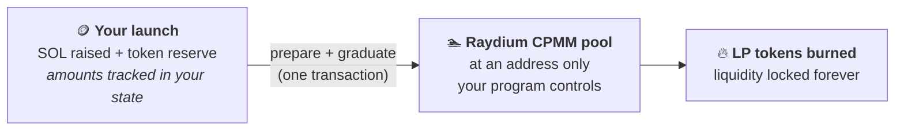
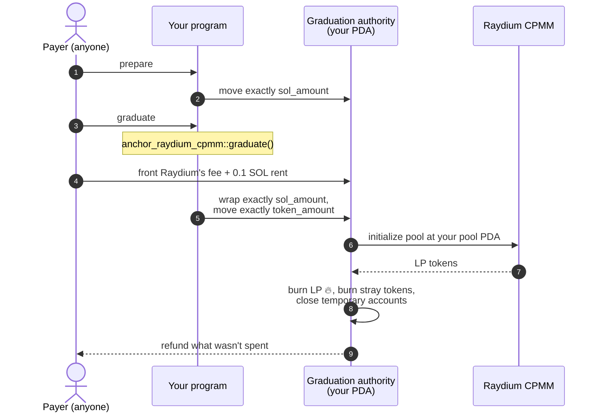

<div align="center">

# anchor-raydium-cpmm

**Graduate a token from your Anchor program into a Raydium pool, and lock the liquidity.**<br/>
The last step of every bonding-curve launchpad, done safely in one function call.

[](https://github.com/KevinGod1234/anchor-raydium-cpmm/actions/workflows/ci.yml)
[](#status)
[](#proof-it-works)
[](https://www.anchor-lang.com)
[](#licence)

</div>

> [!WARNING]
> **For learning and experimenting, not for mainnet (yet).** Unaudited and not
> on crates.io. Build and test with it on devnet or localnet; don't put real
> users' funds behind it. The licences come with no warranty.

## What it does

A launchpad sells a token on a bonding curve. When the curve sells out, the
SOL it raised and a reserve of tokens have to become a DEX pool that nobody
can pull the liquidity out of. That is **graduation**:



Inside your instruction, `graduate()` does all of it:



## Quick start

```toml
[dependencies]
# Pin a commit: the API can change before 1.0. Add features = ["devnet"] for devnet.
anchor-raydium-cpmm = { git = "https://github.com/KevinGod1234/anchor-raydium-cpmm", rev = "<commit>" }
```

Your `graduate` instruction pins its accounts (copy the
[example's `Graduate` struct](examples/launchpad/src/lib.rs)), then makes one
call:

```rust
use anchor_raydium_cpmm::{graduate, GraduateAccounts, GraduateParams, LpLock};

pub fn graduate_launch(ctx: Context<Graduate>) -> Result<()> {
    let launch = &mut ctx.accounts.launch;
    require!(launch.pool.is_none(), MyError::AlreadyGraduated);

    let outcome = graduate(
        GraduateAccounts { /* the 23 accounts from your struct */ },
        GraduateParams {
            sol_amount: launch.sol_raised,       // tracked, never a balance
            token_amount: launch.token_reserve,  // tracked, never a balance
            authority_seeds: &[b"graduation", mint.as_ref(), &[auth_bump]],
            pool_seeds: &[b"pool", mint.as_ref(), &[pool_bump]],
            token_source_seeds: &[b"launch", mint.as_ref(), &[launch.bump]],
            lp_lock: LpLock::Burn,               // liquidity locked forever
            open_time: 0,                        // trading opens right away
        },
    )?;

    launch.pool = Some(outcome.pool);            // never graduate twice
    Ok(())
}
```

Clients send both steps in one transaction:

```text
[ SetComputeUnitLimit(400_000), prepare, graduate ]
```

The [integration guide](docs/integration.md) walks through it step by step,
including the `prepare` instruction you write yourself.

## What it protects against

| Pitfall | What could go wrong | How it's handled |
|---|---|---|
| 🏃 **Front-running the pool** | Someone creates your pool first and sets the opening price. | The pool lives at a PDA of *your* program. Only you can sign for it. |
| 💸 **Inflated balances** | Anyone can send SOL or tokens to any account, skewing a pool funded "from the balance". | The pool gets exactly the amounts you pass in. Planted tokens are burned. |
| 🧩 **The 20-account CPI** | One wrong writable or signer flag, or mints in the wrong order, and `initialize` fails. | Built and tested for both mint orderings, on SPL Token and Token-2022. |
| 🔓 **Pulling the liquidity** | Whoever holds the LP tokens can withdraw the whole pool. | `LpLock::Burn` burns them all, or `SendTo` an owner you fixed beforehand. |
| 🧹 **Plumbing** | Wrapping SOL, temporary accounts, fees, rent, refunds. | Done for you; temporary accounts closed, unspent SOL refunded. |
| ⛓️ **Two-instruction rule** | Solana rejects a direct lamport move followed by a CPI in one instruction. | `prepare` + `graduate`, with the guard pattern [documented](docs/integration.md#3-write-prepare). |

Your own program still has a few duties (graduate once, pin the fee tier,
check a launch *can* graduate). They're on the
[security checklist](docs/security.md#checklist).

## Proof it works

- **Devnet (2026-10-14).** The example program graduated a launch of 0.3 SOL
  and 1,000,000 tokens in
  [one transaction](https://explorer.solana.com/tx/2J3Cxh58GHr1tNQb1eNNTGPgAXcWAMDbvYkHwbjz5bpAPWNPf5wPDbABJgcQteaodyzcHRuXEUbiGNskp19JSAZK?cluster=devnet)
  into [this pool](https://explorer.solana.com/address/65D956f3SvBDEA8iuaihQd7nFR2v76hkzasUw3K9rdRf?cluster=devnet).
  The vaults hold exactly the tracked amounts, the LP supply is 0, and every
  temporary account is closed. [Run it yourself](docs/integration.md#run-it-on-devnet).
- **23 integration tests** in [LiteSVM](https://github.com/LiteSVM/litesvm)
  against Raydium, SPL Token and Token-2022 **as deployed on mainnet**, not
  mocks. They cover both mint orderings, both token programs, donations,
  rival pools, and every attack from the security reviews.
- **Two adversarial security reviews** (internal, not an audit). One critical
  and several smaller issues were found in the example program, all fixed
  with regression tests. [Details](docs/security.md#reviews).

| | Mainnet tier 0 (tests) | Devnet tier 0 |
|---|---|---|
| Cost to the payer | 0.190 SOL (0.15 Raydium fee + rent) | 0.179 SOL |
| Compute units (prepare + graduate) | 197k – 258k | ~204k |

## Status

| | |
|---|---|
| ✅ | Pool creation at your PDA, exact amounts, LP burn or delivery, cleanup |
| ✅ | SPL Token and Token-2022 base mints, mainnet and devnet |
| ✅ | Tested on mainnet bytecode, verified on devnet |
| ⚠️ | Not audited, not on crates.io; educational use |
| ❌ | Quote tokens other than SOL, swaps, adding/removing liquidity, AMM v4 / CLMM |

## Documentation

| | |
|---|---|
| 📘 [Integration guide](docs/integration.md) | Step by step: PDAs, `prepare`, `graduate`, fee tier, devnet |
| 📗 [Reference](docs/reference.md) | API, all 23 accounts, costs, error codes, troubleshooting |
| 📕 [Security](docs/security.md) | Your checklist, limitations, the security reviews |
| 🧪 [Example program](examples/launchpad/src/lib.rs) | A complete launchpad to copy from |

## Repository layout

```text
src/
  lib.rs                graduate(), create_pool_fee(), errors
  ids.rs                Raydium addresses (mainnet, or devnet with the feature)
  pda.rs                Raydium's derived addresses
examples/
  launchpad/            example program: create_launch, prepare, graduate
    tests/graduation.rs 23 LiteSVM tests against mainnet bytecode
    tests/fixtures/     Raydium, SPL Token, Token-2022 snapshots (+ licences)
    tests/forwarder/    test-only attacker program
  devnet-run/           script that graduates a launch on devnet
docs/                   integration guide, reference, security
```

## Development

Needs Rust 1.89 (pinned) and the Solana CLI 4.1.x (`cargo build-sbf`), on
Linux or WSL2.

```bash
make test   # build the example for SBPF v0, run all tests (mainnet + devnet IDs)
make ci     # everything CI runs: fmt, tests, clippy -D warnings, cargo-audit
```

## Alternatives

Raydium's own [`raydium-cp-swap`](https://github.com/raydium-io/raydium-cp-swap)
has a `cpi` feature, but pins `anchor-lang = "=1.0.2"` (or Anchor 0.30 on
crates.io) and stops at the bare CPI. There's no PDA pool address, wrapping,
LP lock or cleanup. The other crates are Pinocchio helpers or off-chain
clients. [Full survey](docs/reference.md#alternatives).

## Licence

Dual-licensed under [MIT](LICENSE-MIT) or [Apache-2.0](LICENSE-APACHE), at
your option. Extracted from [riff](https://github.com/use-riff). The Raydium
CPMM program in the test fixtures is Apache-2.0, Copyright Raydium
([licence](examples/launchpad/tests/fixtures/LICENSE-raydium-cp-swap)).
