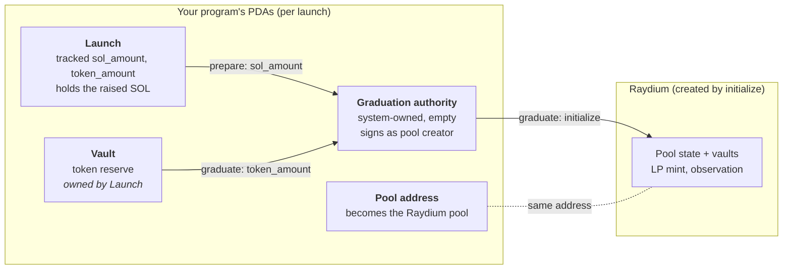

# Integration guide

How to add graduation to your own Anchor program.
[`examples/launchpad`](../examples/launchpad/src/lib.rs) is a complete
program that follows every step here; copy from it.

> [!WARNING]
> Educational and unaudited. Build and test on devnet or localnet.

**Steps:** [1. PDAs](#1-pick-three-pdas) ·
[2. Track amounts](#2-track-the-amounts) · [3. `prepare`](#3-write-prepare) ·
[4. `graduate`](#4-write-graduate) · [5. Pin the fee tier](#5-pin-the-fee-tier) ·
[6. Send it](#6-send-both-in-one-transaction) ·
[Run it on devnet](#run-it-on-devnet)

## The accounts involved



## 1. Pick three PDAs

Per launch (for example seeded by the mint):

| PDA | What it is | Rule |
|---|---|---|
| **Graduation authority** | Signs as the Raydium pool creator. | System-owned and holding nothing else. Anything on it besides `sol_amount` is refunded to the payer. |
| **Pool address** | The Raydium pool is created here. | A PDA of *your* program, never Raydium's default address, so nobody can create your pool first. |
| **Vault owner** | Owns the token reserve (your launch or curve account). | Signs the token transfer with `token_source_seeds`. |

## 2. Track the amounts

Store the SOL raised and the token reserve in your state as you go. Never
compute them from `lamports()` or a token balance: anyone can send SOL or
tokens to any account.

## 3. Write `prepare`

A separate instruction that moves `sol_amount` to the graduation authority.
It has to be separate because Solana rejects a direct lamport move followed
by a CPI that doesn't include both accounts.

It must:

- run only once per launch, and only when your launch is ready;
- **refuse to be called through another program**, and **refuse to run
  unless the next instruction is your `graduate` for the same launch**.
  Otherwise anyone can move the SOL without graduating, and if graduation
  then can't succeed, the SOL is stuck on the authority.

```rust
use anchor_lang::solana_program::instruction::{get_stack_height, TRANSACTION_LEVEL_STACK_HEIGHT};
use solana_instructions_sysvar::{load_current_index_checked, load_instruction_at_checked};

pub fn prepare(ctx: Context<Prepare>) -> Result<()> {
    // 1. Called directly, and graduate of this launch comes next.
    let ixs = ctx.accounts.instructions.to_account_info(); // Sysvar1nstructions…
    let next = load_current_index_checked(&ixs)?
        .checked_add(1)
        .and_then(|i| load_instruction_at_checked(i.into(), &ixs).ok());
    let launch_key = ctx.accounts.launch.key();
    require!(
        get_stack_height() == TRANSACTION_LEVEL_STACK_HEIGHT
            && next.is_some_and(|ix| ix.program_id == crate::ID
                && ix.data.starts_with(instruction::Graduate::DISCRIMINATOR)
                // the launch account's position in your Graduate accounts
                && ix.accounts.get(1).is_some_and(|m| m.pubkey == launch_key)),
        MyError::GraduateMustFollow
    );

    // 2. Once only.
    let launch = &mut ctx.accounts.launch;
    require!(!launch.prepared && launch.pool.is_none(), MyError::AlreadyPrepared);
    launch.prepared = true;

    // 3. Move the tracked SOL. From a program-owned data account, directly:
    let amount = launch.sol_amount;
    launch.sub_lamports(amount)?;
    ctx.accounts.graduation_authority.add_lamports(amount)?;
    Ok(())
}
```

If your SOL sits in a system-owned PDA instead, a `system_program::transfer`
signed with its seeds works too.

## 4. Write `graduate`

Pin every address in `#[derive(Accounts)]`. The example's
[`Graduate` struct](../examples/launchpad/src/lib.rs) shows each constraint,
including `seeds::program = ids::CPMM_PROGRAM_ID` for Raydium's addresses.
Then:

```rust
let outcome = anchor_raydium_cpmm::graduate(
    GraduateAccounts { /* 23 accounts, see the example */ },
    GraduateParams {
        sol_amount: launch.sol_amount,       // tracked
        token_amount: launch.token_amount,   // tracked
        authority_seeds: &[GRADUATION_SEED, mint.as_ref(), &[authority_bump]],
        pool_seeds: &[POOL_SEED, mint.as_ref(), &[pool_bump]],
        token_source_seeds: &[LAUNCH_SEED, mint.as_ref(), &[launch.bump]],
        lp_lock: LpLock::Burn,
        open_time: 0,
    },
)?;
launch.pool = Some(outcome.pool); // and refuse to graduate again
```

`outcome` also tells you `lp_amount` and `cost`, the lamports the payer spent
net of refunds. riff used `cost` to reimburse the caller from protocol fees.

> [!CAUTION]
> `graduate` is usually permissionless, so **never let the caller choose
> where the LP tokens go**. Whoever holds them can withdraw the whole pool.
> For `LpLock::SendTo`, store the owner when the launch is created and check
> the passed account against it, as the example does.

## 5. Pin the fee tier

The crate checks the `AmmConfig` is Raydium's, but not *which* tier it is.
Unpinned, the first caller picks the pool's trading fee forever (mainnet has
tiers up to 4%). Pin it with Raydium's seeds; the same code finds the right
account on devnet:

```rust
pub const FEE_TIER: u16 = 0; // 0.25% trade fee

#[account(
    seeds = [ids::AMM_CONFIG_SEED, &FEE_TIER.to_be_bytes()],
    bump,
    seeds::program = ids::CPMM_PROGRAM_ID,
)]
pub amm_config: UncheckedAccount<'info>,
```

## 6. Send both in one transaction

```text
[ SetComputeUnitLimit(400_000), prepare, graduate ]
```

The compute-budget instruction goes first, never between `prepare` and
`graduate`. Prepare plus graduate used 197k to 258k compute units in the
tests (about 204k on devnet), more than the 200k default. The payer needs
about 0.25 SOL up front on tier 0, and 0.06 of it comes back in the same
transaction ([costs](reference.md#costs)).

Then go through the [security checklist](security.md#checklist).

## Run it on devnet

Build with `features = ["devnet"]` to use Raydium's devnet program and fee
receiver. `pda::amm_config(0)` then gives devnet's tier 0 (`5MxLgy…`, 0.25%
trade fee, 0.15 SOL pool-creation fee). Mainnet tiers don't exist on devnet,
and the crate rejects a fee tier not owned by the Raydium it was built for.

The example program is deployed on devnet at
[`gLsQWe…dcao`](https://explorer.solana.com/address/gLsQWeuzGvG34fKuCwxMbK6zwNUU6Lqoi1173zVdcao?cluster=devnet).
[`examples/devnet-run`](../examples/devnet-run/src/main.rs) creates a token
and a launch, sends `prepare` + `graduate`, and reads the pool back to check
it. It uses about 0.6 devnet SOL:

```bash
cargo run --manifest-path examples/devnet-run/Cargo.toml -- ~/.config/solana/devnet.json
```

The run on 2026-10-14 produced
[this transaction](https://explorer.solana.com/tx/2J3Cxh58GHr1tNQb1eNNTGPgAXcWAMDbvYkHwbjz5bpAPWNPf5wPDbABJgcQteaodyzcHRuXEUbiGNskp19JSAZK?cluster=devnet)
and [this pool](https://explorer.solana.com/address/65D956f3SvBDEA8iuaihQd7nFR2v76hkzasUw3K9rdRf?cluster=devnet).

To deploy the example yourself, set your own program ID in `declare_id!`
(`examples/launchpad/src/lib.rs`), then:

```bash
cargo build-sbf --manifest-path examples/launchpad/Cargo.toml --arch v0 \
  --features devnet --sbf-out-dir target/devnet/deploy
solana program deploy target/devnet/deploy/launchpad.so \
  --program-id <program-keypair.json> --url devnet
```

`examples/devnet-run` is its own crate outside the workspace, so its RPC
client never reaches CI or the published crate.
