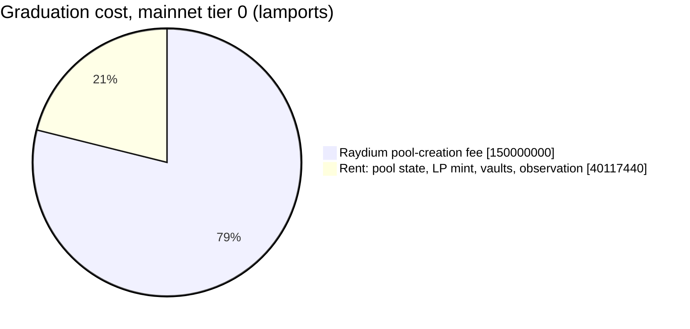

# Reference

[API](#api) · [Accounts](#accounts) · [Costs](#costs) · [Errors](#errors) ·
[Troubleshooting](#troubleshooting) · [Tests](#tests) ·
[Alternatives](#alternatives)

## API

| Item | What |
|---|---|
| `graduate(GraduateAccounts, GraduateParams) -> Result<GraduateOutcome>` | The whole graduation: fund, wrap, create the pool, lock the LP, clean up, refund. |
| `GraduateParams` | `sol_amount`, `token_amount` (tracked), `authority_seeds`, `pool_seeds`, `token_source_seeds` (empty if the source owner signs the transaction), `lp_lock`, `open_time` (0 = now). |
| `GraduateOutcome` | `pool`, `lp_amount` (LP minted, then burned or sent), `cost` (lamports the payer spent net of refunds; 0 if donations left the payer ahead). |
| `LpLock` | `Burn` (liquidity locked forever) or `SendTo { owner, token_account }` (owner fixed in your state, never chosen by the caller). |
| `create_pool_fee(&AccountInfo) -> Result<u64>` | Raydium's pool-creation fee from an `AmmConfig`, after checking Raydium owns it. |
| `ids` | Raydium CPMM program ID, fee receiver, seeds, `initialize` discriminator. Mainnet by default; `devnet` feature for devnet. |
| `pda` | `amm_config(index)`, `pool_authority()`, `lp_mint(pool)`, `vault(pool, mint)`, `observation(pool)`. |
| `GraduateError` | Error codes from 9000, clear of your program's own (6000+). |
| `RENT_ALLOWANCE` | 0.1 SOL fronted for rent on top of the fee; the unspent part is refunded. |

Inside `graduate`, the crate checks the program IDs, the wrapped-SOL mint,
the base mint's owner and writability, and the `AmmConfig` owner. Raydium
checks its own PDAs and the fee receiver; the Associated Token program checks
the temporary account addresses.

## Accounts

The 23 fields of `GraduateAccounts`, in the order the example declares them.
Accounts marked "created here" may also have been created early by anyone;
the crate copes either way.

| Field | Writable | Signer | What / who checks it |
|---|:---:|:---:|---|
| `payer` | ✓ | tx | Fronts the fee and rent; gets the unspent part back. |
| `authority` | ✓ | PDA | System-owned PDA of your program; must already hold `sol_amount`. Signs as pool creator. |
| `base_mint` | ✓ | | The token. Owner must be `base_token_program`; must be writable (both checked by the crate) because stray tokens are burned. |
| `token_source` | ✓ | | Your vault holding the tokens. |
| `token_source_authority` | | PDA or tx | Owner of `token_source`. |
| `authority_base_account` | ✓ | | `authority`'s associated token account for the mint. Created and closed here. |
| `authority_wsol_account` | ✓ | | `authority`'s wrapped-SOL account. Created and closed here. |
| `authority_lp_account` | ✓ | | `authority`'s LP account. Raydium creates it; closed here. |
| `pool_state` | ✓ | PDA | Your pool PDA. Raydium creates it; only your program can sign for it. |
| `amm_config` | | | Raydium fee tier. Owner checked by the crate; pin the tier yourself (`pda::amm_config(index)`). |
| `raydium_authority` | | | `pda::pool_authority()`; checked by Raydium. |
| `lp_mint` | ✓ | | `pda::lp_mint(pool)`; created by Raydium. |
| `base_vault` | ✓ | | `pda::vault(pool, mint)`; created by Raydium. |
| `wsol_vault` | ✓ | | `pda::vault(pool, WSOL)`; created by Raydium. |
| `observation_state` | ✓ | | `pda::observation(pool)`; created by Raydium. |
| `create_pool_fee_receiver` | ✓ | | `ids::CREATE_POOL_FEE_RECEIVER`; checked by Raydium. |
| `wsol_mint` | | | `So111…112`; checked by the crate. |
| `token_program` | | | SPL Token (wrapped SOL and the LP mint); checked by the crate. |
| `base_token_program` | | | SPL Token or Token-2022; checked by the crate. |
| `associated_token_program` | | | Associated Token Account program. |
| `system_program` | | | System program. |
| `rent` | | | Rent sysvar (Raydium still asks for it). |
| `raydium_program` | | | `ids::CPMM_PROGRAM_ID`; checked by the crate. |

For `LpLock::SendTo`, also pass the LP owner and their LP associated token
account (writable). The owner must come from your program's state.

## Costs

Where the payer's SOL goes, measured in the tests on mainnet fee tier 0
(`D4FPEr…BvC2`), with `LpLock::Burn`:



| | Lamports | SOL |
|---|---:|---:|
| Raydium pool-creation fee | 150,000,000 | 0.15 |
| Rent of the pool's accounts | 40,117,440 | ~0.040 |
| **Total `cost` with `Burn`** | **190,117,440** | **~0.190** |
| Plus the LP recipient's account, with `SendTo` | +2,039,280 | ~0.002 |
| Devnet run (tier 0, devnet's Raydium build) | 179,281,120 | ~0.179 |

The payer needs `create_pool_fee + RENT_ALLOWANCE` (0.25 SOL on tier 0) plus
the transaction fee available up front; about 0.06 SOL comes back in the same
instruction. The temporary token accounts' rent is refunded when they're
closed. The crate reads the fee from the `AmmConfig` at runtime, so a Raydium
fee change needs no code change.

## Errors

| Code | Error | Usually means |
|---|---|---|
| 9000 | `InvalidAmmConfig` | The `AmmConfig` isn't owned by Raydium, or is too short. Wrong cluster? |
| 9001 | `InvalidAccount` | A program ID, the wrapped-SOL mint or the base mint's owner doesn't match, or the base mint isn't writable. |
| 9002 | `ZeroAmount` | `sol_amount` or `token_amount` is 0. |
| 9003 | `InsufficientSol` | `authority` holds less than `sol_amount`: `prepare` didn't run in this transaction, or the launch already graduated. |
| 9004 | `MathOverflow` | Should never happen; please open an issue. |

Errors from Raydium (`CPMMoo8…`), the token programs or the Associated Token
program pass through unchanged; the transaction logs show which program
failed.

## Troubleshooting

| Symptom | Fix |
|---|---|
| `Computational budget exceeded` | Add `SetComputeUnitLimit(400_000)` to the transaction. |
| `9003 InsufficientSol` | Send `prepare` and `graduate` in the same transaction, in that order. |
| Example's `GraduateMustFollow` | Send `prepare` directly (not through another program), immediately followed by `graduate` for the same launch. Compute-budget instructions go before `prepare`. |
| `9000 InvalidAmmConfig` on devnet | Build with `--features devnet` and pass a devnet fee tier. |
| Raydium `NotSupportMint` | The Token-2022 mint has an extension Raydium rejects ([list](security.md#limitations)). |
| Raydium `InitLpAmountTooLess` | The launch is too small: `sqrt(sol_amount × token_amount)` must be above 100. |
| LiteSVM won't load your program | Build with `cargo build-sbf --arch v0`. Anchor 1.x defaults to SBPF v3, which LiteSVM's default runtime rejects. |
| `anchor-spl: enable exactly one of the solana-v3 or solana-v4 features` | Add `"solana-v3"` to `anchor-spl`'s features (1.2.1+) with `default-features = false`. |

## Tests

```bash
make test   # build the example (SBPF v0) + test-only programs, run all tests
make ci     # fmt, tests, clippy -D warnings, cargo-audit: what CI runs
```

[`examples/launchpad/tests/graduation.rs`](../examples/launchpad/tests/graduation.rs)
runs 23 tests in LiteSVM against Raydium CPMM, SPL Token and Token-2022 as
deployed on mainnet ([fixtures](../examples/launchpad/tests/fixtures)):

| Area | Covered |
|---|---|
| Pool creation | Mint sorting before and after wrapped SOL, on SPL Token and Token-2022; the pool opens at exactly `sol_amount / token_amount` |
| LP lock | Every LP token burned, or delivered with `SendTo`; the caller can't choose the recipient |
| Cleanup and cost | Temporary accounts closed, authority emptied, payer charged exactly `cost` |
| Griefing | Donations to the authority, its temporary accounts, the pool address or any address the graduation creates change nothing; planted tokens are burned; a rival pool at Raydium's default address doesn't block us |
| Misuse | Graduating twice, without `prepare`, with a foreign `AmmConfig` or another fee tier, `prepare` alone, through another program (test-only attacker program) or for another launch: all refused |
| Documented behaviour | Token-2022 extensions Raydium accepts, the minimum size, creator fees off, freeze authority, the largest transaction fitting in 1232 bytes |

## Alternatives

Surveyed 2026-10:

| Option | What it is | Why not enough |
|---|---|---|
| [`raydium-cp-swap`](https://github.com/raydium-io/raydium-cp-swap) | Raydium's program, with a `cpi` feature | Pins `anchor-lang = "=1.0.2"` (Anchor 0.30 on crates.io); bare CPI only: no PDA pool address, wrapping, LP lock or cleanup |
| [raydium-cpi-example](https://github.com/raydium-io/raydium-cpi-example) | Example programs | Not a library; same Anchor constraint |
| `pinocchio-raydium-cpmm-cpi` | CPI helpers | For Pinocchio, not Anchor |
| `raydium-cp-swap-cpi`, `raydium_cpmm`, `raydium-cpmm-rust-sdk` | Bindings and clients | Off-chain clients or bare CPI bindings |

None covers the launchpad graduation flow, so this crate builds the
20-account CPI itself (about 30 lines) instead of taking on a pinned
dependency.
