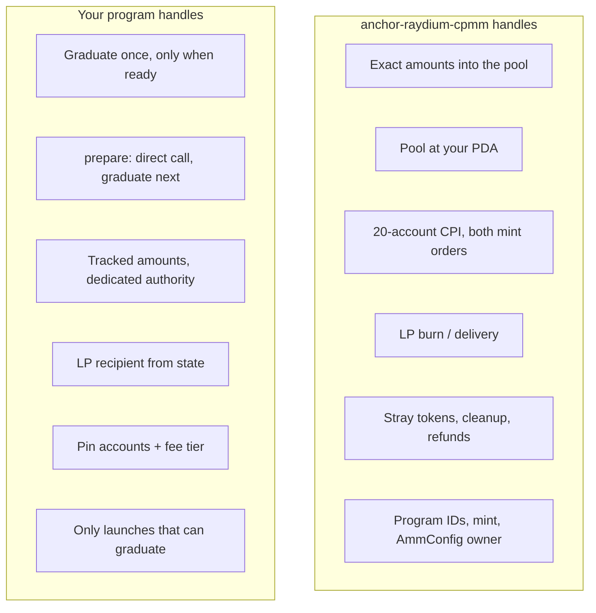

# Security

[Checklist](#checklist) · [Limitations](#limitations) · [Reviews](#reviews)

> [!WARNING]
> **Not audited.** Two internal adversarial reviews are not an audit. Use
> this for learning and on devnet; get your own review and audit before any
> mainnet use.

## Who handles what

## Checklist

The crate handles the graduation itself. Your program is responsible for
the rest:

- [ ] **Graduate once.** Record the pool (or a flag) and refuse a second
  `prepare` or `graduate`. The crate can't see your state.
- [ ] **Only when ready.** Check your own condition (curve sold out,
  deadline passed…) in both `prepare` and `graduate`.
- [ ] **`prepare` only right before `graduate`.** It must be called directly
  (no CPI), and the next instruction must be `graduate` for the same launch
  ([how](integration.md#3-write-prepare)). Otherwise the SOL can be moved and
  then stranded.
- [ ] **Tracked amounts.** `sol_amount` and `token_amount` come from your
  state, never from `lamports()` or a token balance.
- [ ] **Dedicated authority.** The graduation authority holds nothing but the
  SOL for this pool. Everything else on it goes to the payer.
- [ ] **LP recipient from state.** With `LpLock::SendTo`, the owner is fixed
  before graduation and checked, never taken from the caller. Refuse your own
  PDAs as recipient: the authority can't close an LP account holding LP, so
  graduation would never succeed.
- [ ] **Pinned addresses.** Pin every account in `#[derive(Accounts)]`: the
  seeds of your PDAs, `seeds::program = ids::CPMM_PROGRAM_ID` for Raydium's,
  the program IDs, and **the fee tier you chose**
  ([how](integration.md#5-pin-the-fee-tier)).
- [ ] **Pool PDA.** `pool_state` is a PDA of your program, never Raydium's
  default address, so nobody can create your pool first.
- [ ] **Only launches that can graduate.** When a launch is created, refuse
  amounts with `sqrt(sol_amount × token_amount) <= 100`, Token-2022 mints with
  an extension Raydium rejects, and non-zero transfer fees
  ([limitations](#limitations)). Otherwise the launch can never graduate,
  and you need a way to give the funds back.
- [ ] **Who creates a launch.** Seed launches so nobody can claim one for
  someone else's mint at their own price. The example's `create_launch` is a
  stand-in that doesn't do this; don't copy it.
- [ ] **No mint or freeze authority.** A launch mint normally has a fixed
  supply and no freeze authority. Whoever holds a freeze authority can block
  graduation (by freezing the authority's token account, which anyone can
  create early) and freeze the pool's vault later.
- [ ] **Open time.** `open_time: 0` opens trading immediately. The crate
  passes the value through unchecked, so cap it if it comes from user input,
  or the pool may stay closed indefinitely.
- [ ] **Review and audit** before any mainnet use.

## Limitations

- **Quote token is SOL only.** No USDC or other quote tokens yet.
- **Token-2022 extensions**, tested against the mainnet Raydium program:

  | Graduates | Doesn't graduate (the transaction reverts) |
  |---|---|
  | no extensions | permanent delegate |
  | metadata pointer | mint close authority |
  | interest-bearing | transfer hook (even with no hook program) |
  | transfer fee at 0% | default account state (even `Initialized`) |
  | | pausable |
  | | transfer fee above 0% |

  A non-zero transfer fee fails because the authority receives less than
  `token_amount`. Whoever holds a mint's transfer-fee authority can raise the
  fee later and so block graduation; launch mints shouldn't have one.
  Raydium accepts some otherwise-rejected mints from its own allowlist, but
  only with extra accounts this crate doesn't pass, so those aren't supported
  either.
- **Minimum size.** Raydium locks 100 LP tokens, so
  `sqrt(sol_amount × token_amount)` must be above 100. At exactly 100 the
  pool is created with 0 LP for you.
- **Creates pools only.** No swaps, adding or removing liquidity, or Raydium
  AMM v4 / CLMM.
- **`prepare` is yours.** How your SOL reaches the authority depends on how
  you store it, so the crate leaves that step to you.
- **Burn is final.** `LpLock::Burn` locks the liquidity forever. Nobody can
  withdraw it, and Raydium's LP fee-claim lockers don't apply.
- **Fixtures age.** Raydium and the token programs can be upgraded. Refresh
  the [fixtures](../examples/launchpad/tests/fixtures) and re-run the tests
  before relying on them.

## Reviews

Two internal adversarial reviews (2026-10) tried to break the crate and the
example, each finding backed by a LiteSVM test. **Neither found a way to
steal funds or block a graduation through the crate itself.** Everything they
found is fixed and covered by a regression test:

| Severity | Where | Issue | Fix |
|---|---|---|---|
| Critical | Example | Any caller could name the LP recipient, take every LP token and withdraw the whole pool. | Recipient fixed at launch creation and checked; `SendTo` documented. |
| Medium | Example | Fee tier not pinned: the first caller chose it, forever. | Pinned to tier 0 by Raydium's seeds. |
| Low | Example | `prepare` alone could strand the SOL if graduation then failed. | `prepare` requires `graduate` next. |
| Low | Crate | Base mint writability not checked (a donated token could then block graduation). | Checked. |
| Low | Example | `prepare` called through another program got past that check. | `prepare` must be called directly, followed by `graduate` of the same launch. |
| Info | Example | The creator could name one of our PDAs as LP recipient, making graduation impossible. | Refused at `create_launch`. |
| Info | Docs | Launches that can never graduate, freeze authority, unchecked `open_time`. | Documented in the [checklist](#checklist) and [limitations](#limitations). |

Checked and found safe: SOL sent ahead of time to any address the graduation
creates; rival pools at Raydium's default address; swapped program IDs; price
manipulation through donations; Raydium creator fees (they stay off, so
nothing accrues to the authority); making the program's PDAs sign anything
else; substituting the LP recipient's token account.
